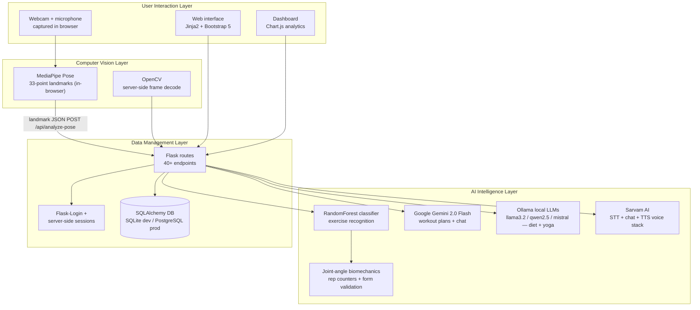
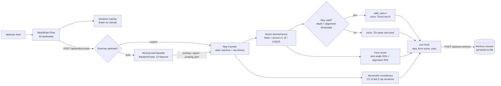
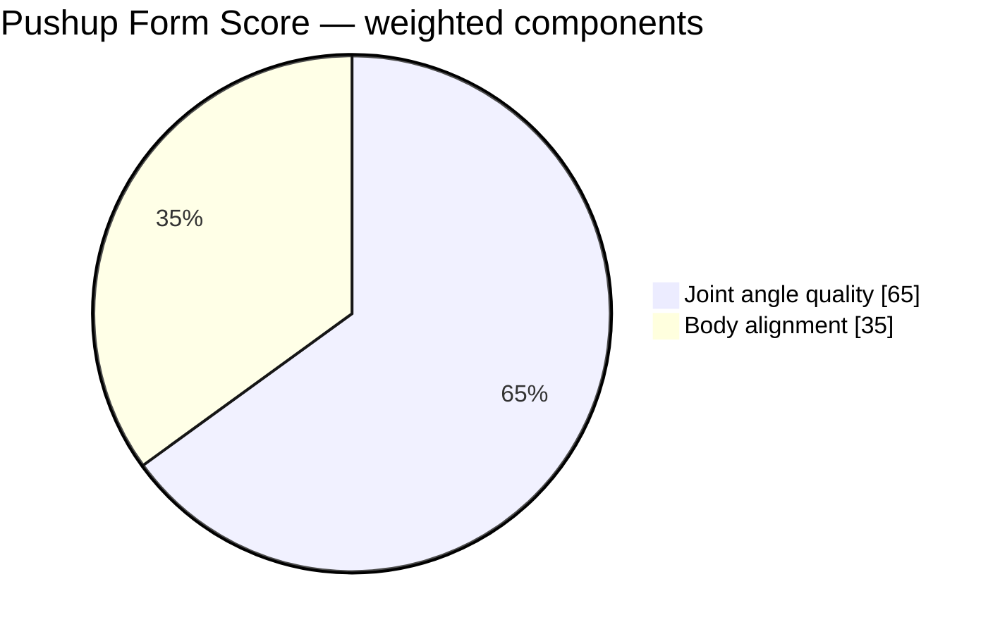
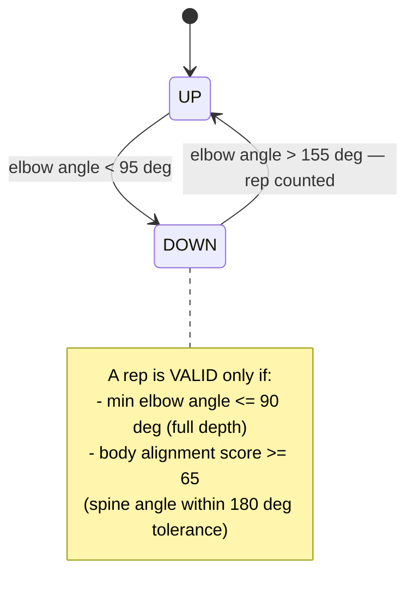
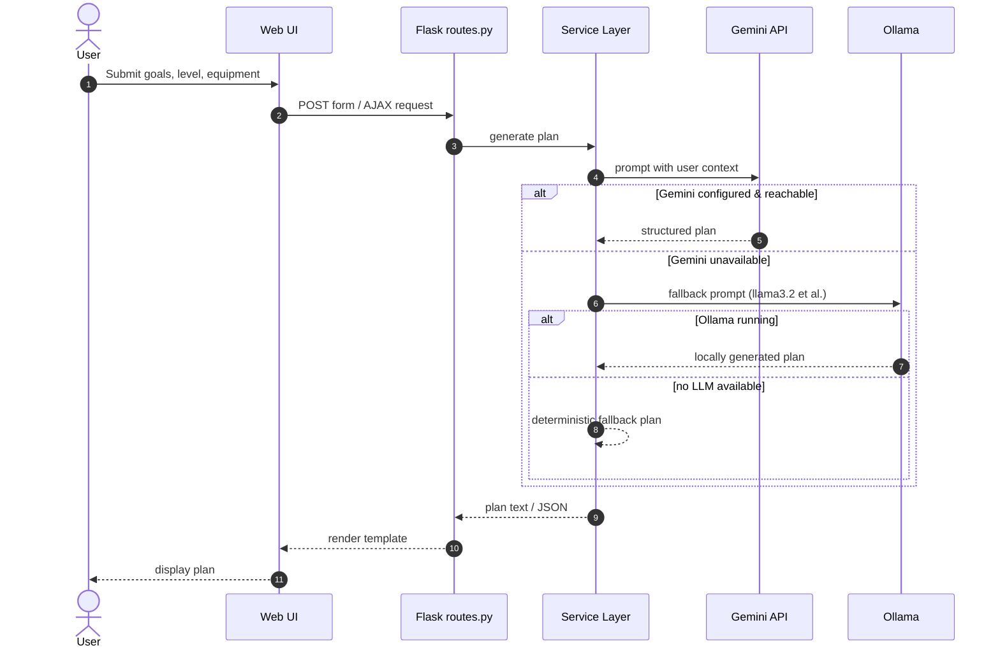
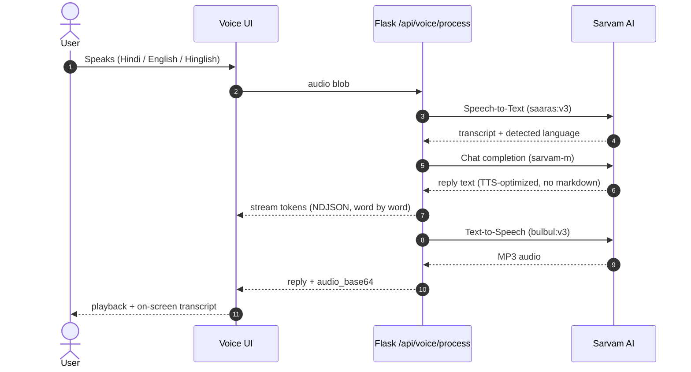
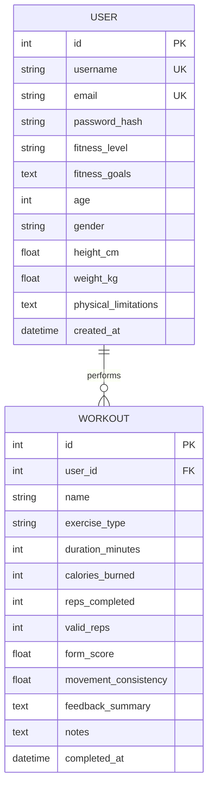
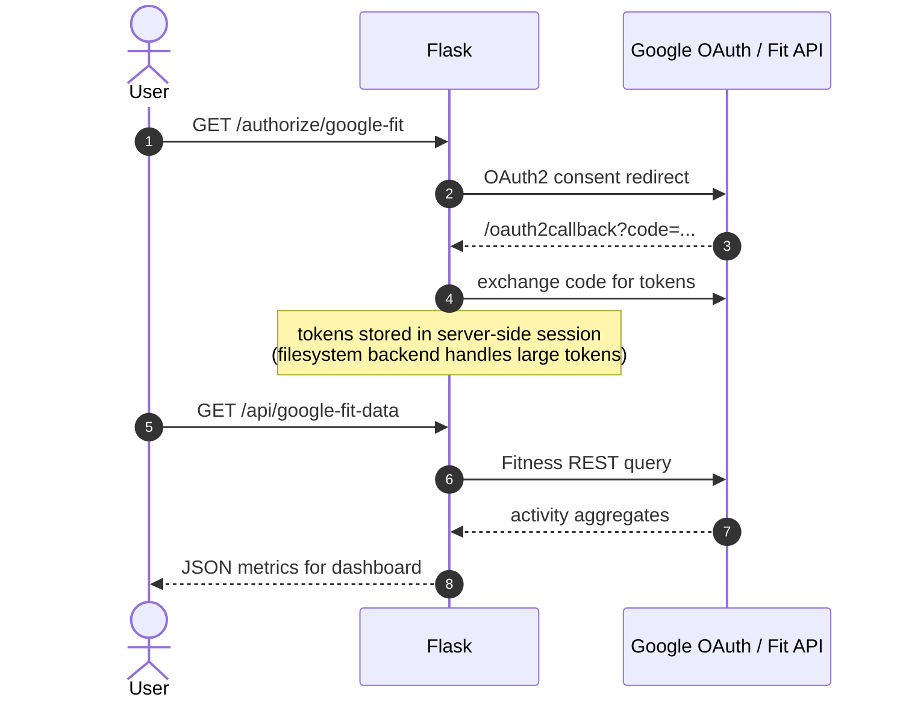
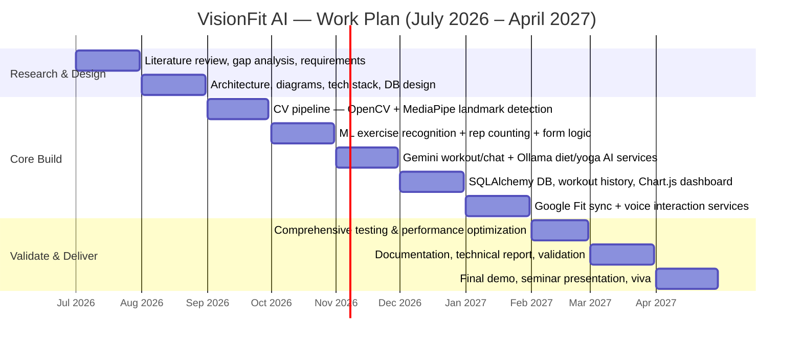
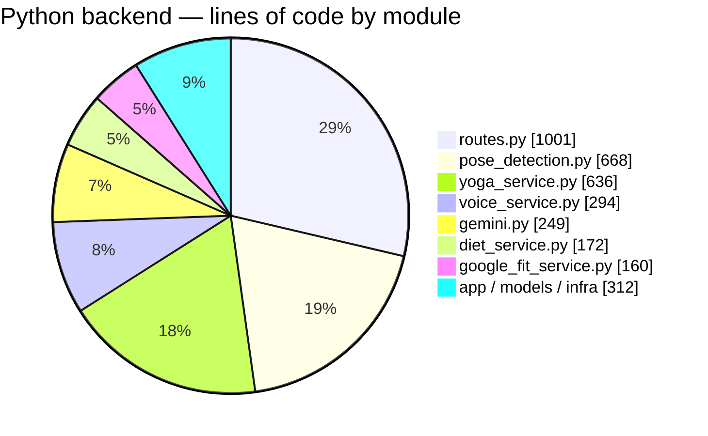

# VisionFit AI — Intelligent Virtual Fitness Coach 🏋️‍♂️🥗🧘‍♀️


> **B.Tech (CSE — Artificial Intelligence) major project**
> School of Engineering, Babu Banarasi Das University, Lucknow · August 2026
> **Team:** Rishabh Verma · Nootan Tiwari · Riya Singh · Pritam Dey — **Supervisor:** Ms. Mala Chaturvedi, Assistant Professor

**VisionFit AI** is an intelligent virtual fitness coach that combines **Computer Vision**, **Machine Learning**, and **Generative AI** into a single unified platform. It continuously analyzes user movements through a webcam, identifies the performed exercise using a trained machine learning model, evaluates exercise form in real time, and provides corrective feedback instantly — while cloud and locally-hosted AI generate personalized workout, diet, and yoga plans.

---

## 📋 Table of Contents

1. [Introduction](#1-introduction)
2. [Problem Statement](#2-problem-statement)
3. [Objectives](#3-objectives)
4. [Scope of the Project](#4-scope-of-the-project)
5. [Literature Review](#5-literature-review)
6. [Methodology / Proposed System](#6-methodology--proposed-system)
7. [Module Description](#7-module-description)
8. [Expected Outcomes](#8-expected-outcomes)
9. [Hardware & Software Requirements](#9-hardware--software-requirements)
10. [Work Plan / Timeline](#10-work-plan--timeline)
11. [References](#11-references)
12. [Project Structure](#12-project-structure)
13. [Getting Started](#13-getting-started)
14. [Usage Guide](#14-usage-guide)
15. [API Reference](#15-api-reference)
16. [Deployment](#16-deployment)
17. [Security Notes](#17-security-notes)
18. [Contributing](#18-contributing)
19. [License](#license)

---

## 1. Introduction

Artificial Intelligence has transformed the way people interact with digital systems, particularly in healthcare, fitness, and personalized recommendation systems. Traditional fitness applications primarily provide pre-recorded exercise videos, static workout plans, and manual progress tracking. While these applications help users begin their fitness journey, they lack the ability to monitor exercise execution, provide real-time corrections, and adapt recommendations based on user performance.

Maintaining correct exercise posture is one of the biggest challenges for individuals exercising without professional supervision. Incorrect body alignment during exercises such as squats, push-ups, or jumping jacks can significantly reduce workout effectiveness and increase the risk of injuries. Similarly, most existing fitness platforms separate workout planning, nutrition guidance, and wellness management into different applications, creating a fragmented user experience.

VisionFit AI addresses this as an intelligent virtual fitness coach that combines Computer Vision, Machine Learning, and Generative Artificial Intelligence into a single unified platform. Unlike conventional fitness applications, the system continuously analyzes user movements through a webcam, identifies the performed exercise using a trained machine learning model, evaluates exercise form in real time, and provides corrective feedback instantly.

The project follows a **hybrid AI architecture**. Cloud-based intelligence through **Google Gemini 2.0 Flash** is used for personalized workout planning and conversational assistance, while privacy-sensitive features such as diet planning and yoga generation are executed locally through **Ollama**, which hosts models including **Llama 3.2, Qwen 2.5, and Mistral**. A **Sarvam AI** voice stack enables bilingual (Hindi / English) hands-free interaction.

**Quick feature overview:**

| Module | Powered By | What It Does |
|---|---|---|
| 🤖 **AI Workout Planner** | Gemini 2.0 Flash → Ollama fallback | Generates 4-week plans from fitness level, goals, equipment & physical limitations |
| 📹 **Real-Time Exercise Analysis** | MediaPipe + scikit-learn + OpenCV | Live webcam form tracking for **Pushups, Squats, Jumping Jacks** with rep counting, form score & voice cues |
| 🍎 **AI Diet Planner** | Ollama (`llama3.2`, auto-detects models) | 1-day meal plans with macros (protein / carbs / fats / calories), respects preferences & allergies |
| 🧘 **AI Yoga Instructor** | Ollama | Custom yoga flows by mood, goal & duration — includes Chair/Bed yoga for limited mobility, with 26 pose illustrations |
| 💬 **AI Fitness Chat** | Gemini 2.0 Flash → Ollama fallback | Context-aware Q&A assistant that knows your profile |
| 🎙️ **Bilingual Voice Assistant** | Sarvam AI (`saaras:v3` STT · `sarvam-m` chat · `bulbul:v3` TTS) | Hands-free Hindi / English / Hinglish conversation, streaming responses |
| 📊 **Dashboard & Google Fit** | Chart.js + Google Fit API | Workout stats, calories, streaks, progress charts, and OAuth2-based Google Fit sync |

---

## 2. Problem Statement

Despite the rapid growth of digital fitness platforms, existing solutions continue to suffer from several significant limitations:

- **No real-time feedback** — most applications rely on static instructional videos where users independently imitate exercises without receiving any real-time feedback regarding their posture or movement quality. This often leads to incorrect exercise execution, inefficient workouts, and increased risk of physical injuries.
- **Limited personalization** — workout plans are generally predefined and rarely adapt dynamically to individual characteristics such as fitness level, physical limitations, injury history, available equipment, or performance progression.
- **Rule-based rigidity** — although recent advancements in computer vision have enabled pose estimation using body landmarks, many existing systems rely on manually defined angle thresholds to evaluate exercises. These rule-based approaches perform well under ideal conditions but struggle to generalize across different body types, camera angles, movement speeds, and complex exercise variations.
- **Cloud dependency** — many AI-powered fitness applications depend entirely on cloud-based processing, raising concerns regarding data privacy, recurring API costs, and internet dependency.

The proposed system addresses these limitations by introducing an intelligent exercise recognition model trained on exercise movement data, combining it with MediaPipe-based landmark detection and hybrid AI services to deliver real-time, adaptive, and privacy-aware fitness coaching.

---

## 3. Objectives

The primary objective of VisionFit AI is to develop an intelligent fitness coaching platform that combines computer vision, machine learning, and generative AI to provide personalized and real-time fitness assistance.

- To develop a **real-time exercise recognition system** using computer vision and a trained machine learning model.
- To detect and analyze human body movements through **MediaPipe's 33-point landmark estimation**.
- To **classify specific exercises** and determine whether they are performed correctly.
- To provide **instant corrective feedback** based on movement analysis.
- To generate **personalized workout plans** using Google Gemini 2.0 Flash.
- To implement **privacy-preserving diet and yoga recommendation systems** using locally hosted LLMs through Ollama.
- To maintain **user workout history, analytics, and progress tracking** through a structured database.
- To design a **scalable modular architecture** suitable for future enhancements.

---

## 4. Scope of the Project

VisionFit AI is designed as a comprehensive web-based intelligent fitness platform capable of integrating multiple AI technologies into a unified user experience.

**In scope:**

- Real-time webcam-based exercise recognition.
- Machine learning-based exercise classification (RandomForest — pushup / squat / jumping_jack / idle).
- Pose landmark extraction using MediaPipe (33 landmarks).
- AI-generated personalized workout plans.
- Local AI-powered diet and yoga recommendations.
- User authentication and profile management.
- Performance analytics dashboard.
- Google Fit integration (OAuth 2.0).
- Voice-based AI interaction (Hindi / English / Hinglish).

**Out of scope (identified as future enhancements):**

- Wearable sensor integration.
- Full 3D motion capture.
- Advanced gym equipment recognition.
- A dedicated mobile application.

---

## 5. Literature Review

The development of VisionFit AI is supported by research conducted across multiple domains including human activity recognition, computer vision, exercise biomechanics, and generative AI. Human activity recognition has evolved significantly through computer vision techniques that analyze body movements using image-based features. Early approaches relied heavily on handcrafted features and traditional image processing, which were highly sensitive to environmental conditions.

The introduction of deep learning-based pose estimation models such as **OpenPose** and **MediaPipe BlazePose** dramatically improved landmark detection accuracy. MediaPipe, in particular, offers efficient real-time detection of 33 body landmarks while maintaining low computational requirements, making it highly suitable for consumer-grade hardware.

Recent research has also explored AI-assisted fitness coaching using conversational AI models. However, most existing systems generate textual recommendations without validating whether users actually perform exercises correctly. Similarly, many commercial applications such as **MyFitnessPal**, **Fitbit**, and **Nike Training Club** focus on tracking activities rather than intelligently analyzing exercise execution.

VisionFit AI extends existing research by combining:

- Real-time pose estimation.
- Machine learning-based exercise recognition.
- Generative AI planning.
- Local AI privacy mechanisms.

This integrated approach addresses several limitations identified in previous research.

---

## 6. Methodology / Proposed System

The proposed system follows a **modular hybrid architecture consisting of four major layers**:

| Layer | Responsibility |
|---|---|
| **User Interaction Layer** | Manages user authentication, profile management, webcam input, and interaction with the web interface. |
| **Computer Vision Layer** | Uses MediaPipe (in-browser) to extract 33 body landmarks from webcam frames for movement analysis; OpenCV handles server-side frame decoding. |
| **AI Intelligence Layer** | Combines a trained exercise recognition model with Google Gemini and Ollama to provide exercise analysis and personalized recommendations. |
| **Data Management Layer** | Stores user profiles, workout history, and performance analytics using Flask and SQLAlchemy. |

### 6.1 System Architecture



**Workflow:** the user performs an exercise in front of the webcam. The video stream is captured in the browser, after which MediaPipe extracts 33 body landmarks representing major joints and body positions. Instead of relying solely on predefined joint-angle thresholds, these landmarks are passed to a **trained machine learning exercise recognition model** that identifies the performed exercise. Biomechanical joint-angle analysis then evaluates movement quality, counts repetitions, and validates form. Simultaneously, AI services generate personalized recommendations — Google Gemini handles workout planning and conversational reasoning, while Ollama executes local diet and yoga generation without transmitting sensitive user information to external servers. Finally, the processed results are stored in the SQLAlchemy-managed database and displayed through an interactive dashboard.

### 6.2 Real-Time Exercise Analysis Flowchart

The browser extracts 33 body landmarks with MediaPipe — no video ever leaves the machine, only landmark coordinates.



### 6.3 Algorithms Used

The system combines multiple algorithms rather than relying on a single approach.

**MediaPipe Pose Estimation** — MediaPipe extracts 33 body landmarks from every video frame, providing precise skeletal information for movement analysis.

**Trained Exercise Recognition Model** — a `RandomForestClassifier` (35 estimators, max depth 8, 12 landmark-derived features) learns exercise movement patterns from training data instead of depending only on manually defined angle thresholds. The model performs **exercise classification** across four classes (`pushup`, `squat`, `jumping_jack`, `idle`). Form validation, movement-consistency analysis, and repetition recognition are then performed by dedicated biomechanical analyzers — a hybrid approach where data-driven classification guides rule-based, physiologically-grounded evaluation:

- **Form validation** — each rep is checked for full depth (min elbow/knee angle ≤ 90°) and body alignment (spine angle within tolerance of 180°).
- **Correct repetition recognition** — finite-state machines track the up/down phases of each exercise.
- **Movement consistency analysis** — the coefficient of variation of the last 5 rep durations measures pacing stability.

**Joint Angle Analysis** — biomechanical calculations support movement evaluation by measuring relationships between joints. The joint angle is calculated using vector mathematics:

```
θ = cos⁻¹( (v₁ · v₂) / (|v₁| · |v₂|) )
```

Pushup form score composition (real scoring weights from `pose_detection.py`):



**Generative AI** — every LLM feature degrades gracefully: cloud model first, local model second, deterministic plan last.

- Google Gemini 2.0 Flash generates: personalized workout plans and contextual fitness responses.
- Local Ollama models generate: diet recommendations and yoga routines.
- Sarvam AI powers: speech-to-text, bilingual chat, and text-to-speech for the voice assistant.

### 6.4 Pushup Rep-Counting State Machine



---

## 7. Module Description

The VisionFit AI system is designed using a modular architecture, where each module performs a specific function while communicating seamlessly with the Flask backend. This modular approach improves scalability, maintainability, and future enhancements, allowing new features to be integrated without affecting the overall system.

### Module 1: Data Collection

The Data Collection module serves as the entry point of the system by gathering all the necessary inputs required for fitness analysis. During user registration, the system securely stores profile information such as age, gender, height, weight, fitness goals, and physical limitations. For exercise analysis, the webcam continuously captures live video frames, which become the primary input for the computer vision pipeline. This module ensures that both personal information and real-time visual data are available for personalized recommendations and movement analysis.

### Module 2: Preprocessing

The Preprocessing module prepares the captured video data for further analysis by improving frame quality and extracting meaningful information. MediaPipe (running in the browser) detects and extracts 33 body landmarks representing important joints and body positions; OpenCV supports server-side frame decoding for the image-upload path. These landmarks provide a structured skeletal representation of the user's posture, making subsequent exercise recognition more accurate and computationally efficient.

### Module 3: Exercise Recognition

The Exercise Recognition module is the core component of the system. A trained Machine Learning model (`RandomForestClassifier`, 4 classes, 12 features) recognizes exercise patterns from landmark frames and identifies the exercise being performed. Dedicated biomechanical analyzers then validate whether the movement is executed correctly, count repetitions, and evaluate overall movement quality. This data-driven-plus-biomechanical approach improves accuracy across different body types, movement speeds, and camera angles.

### Module 4: AI Recommendation Engine

The AI Recommendation Engine provides personalized fitness guidance by combining cloud-based and locally hosted artificial intelligence models. Google Gemini 2.0 Flash generates customized workout plans and responds to fitness-related queries through conversational AI. At the same time, Ollama-hosted local models, including Llama 3.2, Qwen 2.5, and Mistral, generate personalized diet plans and yoga routines while keeping sensitive user information on the local device. This hybrid architecture balances intelligent recommendations with improved privacy and reduced API dependency.



The same engine powers the **bilingual voice assistant** — Sarvam AI speech-to-text (`saaras:v3`), chat (`sarvam-m`), and text-to-speech (`bulbul:v3`) with streaming NDJSON responses:



### Module 5: Database Management

The Database Management module is responsible for securely storing and organizing all user-related information throughout the application. Using SQLAlchemy as the Object-Relational Mapping (ORM) framework, the system maintains user profiles, workout history, exercise logs, repetition counts, form evaluation results, and progress metrics. This structured storage enables long-term performance tracking and provides historical data for personalized recommendations.



### Module 6: Dashboard

The Dashboard module transforms stored fitness data into meaningful visual insights. Using Chart.js, the system presents interactive charts that display workout frequency, completed repetitions, performance trends, and progress over time. The dashboard provides users with an easy-to-understand overview of their fitness journey, helping them stay motivated through measurable improvements. **Google Fit** telemetry (steps, calories, heart rate) can be merged in via OAuth 2.0:



### Module 7: Testing

The Testing and Validation module ensures that the entire system performs reliably under real-world conditions. The computer vision pipeline is evaluated under different lighting conditions, camera angles, body positions, and movement speeds to verify robustness. The exercise recognition model is also tested for prediction accuracy, response time, and consistency to ensure smooth real-time performance across various usage scenarios.

---

## 8. Expected Outcomes

The proposed system is expected to deliver significant improvements over conventional fitness applications:

- Accurate real-time exercise recognition.
- Improved exercise form validation.
- Personalized workout recommendations.
- Privacy-preserving AI assistance.
- Reduced dependency on cloud services.
- Better user engagement through interactive feedback.
- Structured progress tracking.
- Scalable modular architecture.

---

## 9. Hardware & Software Requirements

**Hardware Requirements**

- Intel Core i5 or higher processor
- 8 GB RAM (16 GB recommended)
- 256 GB SSD
- HD Webcam (720p minimum, 1080p recommended)
- Internet connectivity
- Dedicated GPU (optional)

**Software Requirements**

- Python 3.11+ · Flask · SQLAlchemy
- OpenCV · MediaPipe
- Google Gemini API · Ollama (Llama 3.2, Qwen 2.5, Mistral)
- Sarvam AI API (voice assistant)
- Bootstrap 5 · Chart.js · Git

---

## 10. Work Plan / Timeline

The development of VisionFit AI follows a structured month-wise implementation plan that ensures systematic progress from research to final deployment. Each phase builds upon the previous stage, allowing continuous development, testing, and refinement of the system.

| Month | Planned Activities |
|---|---|
| **July** | Conduct literature review, analyze existing AI fitness systems, identify research gaps, define project objectives, and finalize system requirements. |
| **August** | Design the overall system architecture, prepare workflow diagrams, select the technology stack, and define the database structure for user and workout management. |
| **September** | Develop the Computer Vision module using OpenCV and MediaPipe, implement webcam-based landmark detection, and establish the real-time video processing pipeline. |
| **October** | Integrate the trained Machine Learning Exercise Recognition model, perform exercise classification, implement form validation, and develop repetition counting logic. |
| **November** | Integrate Google Gemini 2.0 Flash for personalized workout planning and AI chat, and implement Ollama-based local AI models for diet planning and yoga recommendations. |
| **December** | Develop database operations using SQLAlchemy, implement workout history management, build dashboard analytics using Chart.js, and improve user profile management. |
| **January** | Integrate Google Fit synchronization, implement voice interaction services, optimize communication between modules, and improve overall system usability. |
| **February** | Conduct comprehensive testing under different lighting conditions, camera angles, body types, and movement speeds, while optimizing model performance and reducing latency. |
| **March** | Prepare project documentation, finalize the synopsis and technical report, verify all modules, and perform system validation before submission. |
| **April** | Conduct final project demonstration, prepare seminar presentation, perform viva preparation, and complete all submission requirements. |



---

## 11. References

1. M. Vrigkas, C. Nikou, and I. A. Kakadiaris, "A Review of Human Activity Recognition Methods," *Frontiers in Robotics and AI*, vol. 2, 2015.
2. Google Research, "MediaPipe: A Framework for Building Perception Pipelines." Available: [mediapipe.dev](https://mediapipe.dev).
3. OpenCV, "Open Source Computer Vision Library." Available: [opencv.org](https://opencv.org).
4. Google AI, "Gemini API Documentation." Available: [ai.google.dev](https://ai.google.dev).
5. Python Software Foundation, "Python Programming Language." Available: [python.org](https://python.org).
6. Flask Documentation. Available: [flask.palletsprojects.com](https://flask.palletsprojects.com).
7. SQLAlchemy Documentation. Available: [sqlalchemy.org](https://sqlalchemy.org).
8. Chart.js Documentation. Available: [chartjs.org](https://chartjs.org).
9. Ollama Documentation. Available: [ollama.com](https://ollama.com).
10. R. O'Donoghue, *An Introduction to Performance Analysis of Sport*. Routledge, 2017.

---

## 12. Project Structure

```text
VISION-FIT-AI/
├── app.py                  # Application factory, DB + session config
├── run.py                  # WSGI entrypoint (gunicorn run:app)
├── start_app.py            # Local launcher (auto-starts Ollama + Flask)
├── run_visionfit.bat       # One-click Windows launcher
├── routes.py               # 40+ routes: pages + JSON APIs
├── models.py               # User (biometrics + BMI) & Workout models
├── extensions.py           # SQLAlchemy + LoginManager singletons
├── gemini.py               # Gemini engine with Ollama fallback
├── pose_detection.py       # Landmarks, RF classifier, rep counters, feedback
├── diet_service.py         # Ollama nutrition planner
├── yoga_service.py         # Ollama yoga sequence generator
├── voice_service.py        # Sarvam STT + chat + TTS (Hindi/English/Hinglish)
├── google_fit_service.py   # OAuth2 flow + fitness data fetch
├── requirements.txt        # Pinned dependencies
├── runtime.txt             # python-3.11.9
├── Procfile                # web: gunicorn run:app
├── .env.example            # Environment template (placeholders only)
├── static/
│   ├── css/style.css       # Glassmorphic neon theme
│   ├── js/                 # dashboard.js, exercise_analysis.js, pose-detection.js
│   ├── dist/               # Bundled assets
│   ├── yoga_images/        # 26 pose illustrations
│   └── favicon.ico, h1-h4.jpg
├── templates/              # 11 Jinja2 pages (base, dashboard, exercise_analysis,
│                           #  workout_planner, diet, yoga, fitness_chat, voice_assistant …)
└── frontend/               # Optional JS tooling scaffold (package.json only)
```

Backend composition (lines of Python per module):



**Technology stack (matching the synopsis tools & technologies table):**

| Category | Technology |
|---|---|
| Programming | Python 3.11 |
| Backend | Flask 2.3, Flask-Login, Flask-Session (filesystem), Werkzeug |
| Frontend | HTML, CSS, Bootstrap 5, JavaScript, Jinja2, Chart.js |
| Database | SQLite (dev), PostgreSQL (prod) |
| ORM | SQLAlchemy |
| Computer Vision | OpenCV, MediaPipe Pose (client-side), NumPy |
| Pose ML | scikit-learn RandomForestClassifier |
| Cloud AI | Google Gemini 2.0 Flash |
| Local AI | Ollama — Llama 3.2, Qwen 2.5, Mistral |
| Voice AI | Sarvam AI (`saaras:v3`, `sarvam-m`, `bulbul:v3`) |
| Authentication | Flask-Login, Google OAuth 2.0 (Google Fit sync) |
| Charts | Chart.js |
| Deployment | Gunicorn, Procfile, Railway / Render / Heroku |

---

## 13. Getting Started

### Prerequisites
- Python 3.11+
- [Ollama](https://ollama.com/) *(optional — required only for local Diet/Yoga generation)*
- A Google AI Studio key for Gemini *(required for Workout Planner & Chat)*
- A Sarvam AI key *(required for the Voice Assistant)*

### 1. Clone & create a virtual environment
```bash
git clone https://github.com/rishabhverma007/VISION-FIT-AI.git
cd VISION-FIT-AI

python -m venv .venv
# Windows
.venv\Scripts\activate
# macOS / Linux
source .venv/bin/activate
```

### 2. Install dependencies
```bash
pip install -r requirements.txt
```

### 3. Configure environment
```bash
copy .env.example .env    # Windows  (cp on macOS/Linux)
```
Fill in your own keys in `.env` (never commit this file):

```ini
SESSION_SECRET=change-me-to-a-random-string
DATABASE_URL=sqlite:///visionfit.db
GOOGLE_API_KEY=your-gemini-api-key
SARVAM_API_KEY=your-sarvam-api-key
GOOGLE_CLIENT_ID=your_client_id_here          # optional, Google Fit
GOOGLE_CLIENT_SECRET=your_client_secret_here  # optional, Google Fit
GOOGLE_REDIRECT_URI=http://localhost:5000/oauth2callback
PORT=5000
```

### 4. Set up local AI (optional)
```bash
ollama pull llama3.2        # or qwen2.5 / mistral / llama3
```
The services auto-detect whichever preferred model is installed.

### 5. Run

```bash
# Windows one-click (starts Ollama if installed, then Flask):
run_visionfit.bat

# Or directly:
python start_app.py
```

Open **http://localhost:5000** 🎉

---

## 14. Usage Guide

1. **Register / Login** — create an account; biometrics (age, height, weight) power BMI and calorie math.
2. **Dashboard** — view streaks, calories, form-score trends; connect Google Fit for extra telemetry.
3. **Workout Planner** — enter goals, equipment, limitations → get a 4-week plan.
4. **Exercise Analysis** — pick Pushup / Squat / Jumping Jack (or *auto* for ML detection), grant camera access, stand back so your full body is visible, and train with live rep counting, form score and voice cues.
5. **Diet / Yoga** — generate instant plans locally via Ollama (yoga ships with 26 pose illustrations).
6. **Fitness Chat** — ask anything; the assistant has your profile context.
7. **Voice Assistant** — talk in Hindi, English or Hinglish and get spoken replies.

---

## 15. API Reference

| Group | Endpoint | Method | Purpose |
|---|---|---|---|
| Auth | `/register`, `/login`, `/logout` | GET/POST | Account management |
| Pages | `/dashboard`, `/exercise-analysis`, `/workout_planner`, `/diet`, `/yoga`, `/fitness_chat`, `/voice-assistant` | GET | Rendered pages (login required) |
| Pose | `/api/analyze-pose` | POST | Landmarks → reps, form score, feedback |
| Pose | `/api/pose-detection` · `/api/reset-pose-session` | POST | Alternate detector / reset counters |
| Workouts | `/api/save-workout` · `/api/workout-history` · `/api/dashboard-stats` | GET/POST | Persist & aggregate sessions |
| AI | `/api/fitness-chat` · `/api/generate-diet-plan` · `/api/generate-yoga-plan` | POST | LLM-generated content |
| Voice | `/api/voice/process` (streaming) · `/api/voice/process_legacy` · `/api/voice/process_text` · `/api/voice/clear` | POST | STT → chat → TTS pipeline |
| Google Fit | `/authorize/google-fit` · `/oauth2callback` · `/api/google-fit-data` | GET | OAuth2 + telemetry |
| Data | `/api/export-data` · `/api/import-data` · `/api/backup-data` · `/api/restore-data` · `/api/clear-data` | GET/POST | Backup & portability |
| Meta | `/api/health-check` · `/api/version` · `/api/docs` | GET | Ops endpoints |

---

## 16. Deployment

Production-ready for **Railway**, **Render**, or **Heroku**:

- **Entrypoint:** `Procfile` → `web: gunicorn run:app`
- **Runtime:** `runtime.txt` → `python-3.11.9`
- **Port:** binds to `0.0.0.0:$PORT` automatically
- **Proxy:** `ProxyFix` enabled for correct scheme/host behind load balancers

**Steps (Railway/Render):**
1. Connect this GitHub repository.
2. Build command: `pip install -r requirements.txt`
3. Start command: `gunicorn run:app`
4. Set environment variables: `SESSION_SECRET`, `GOOGLE_API_KEY`, `SARVAM_API_KEY`, and optionally `DATABASE_URL` (PostgreSQL URI — the app auto-normalizes Railway's `postgres://` scheme).

---

## 17. Security Notes

- **Never commit `.env`** — it is git-ignored; `.env.example` contains placeholders only.
- If API keys were ever shared or committed accidentally, **rotate them** in Google AI Studio / Sarvam dashboard immediately.
- Sessions are server-side (filesystem) with signed cookies — OAuth tokens never live in the browser.
- Passwords are hashed with Werkzeug PBKDF2.

---

## 18. Contributing

Contributions are welcome! Fork the repository, create a feature branch, and open a pull request.

## 📄 License

[MIT License](LICENSE) — Copyright (c) 2026 Rishabh Verma
