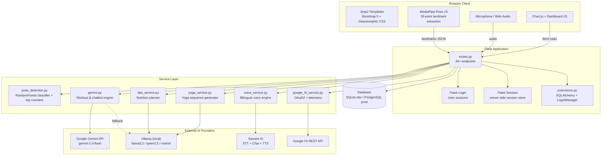
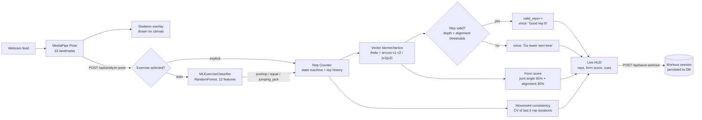
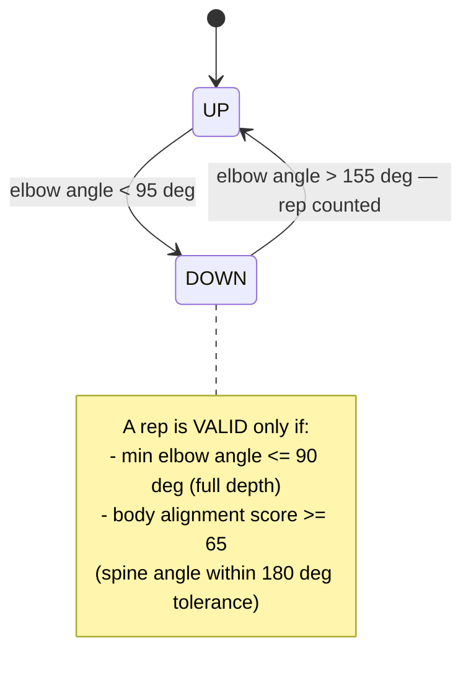
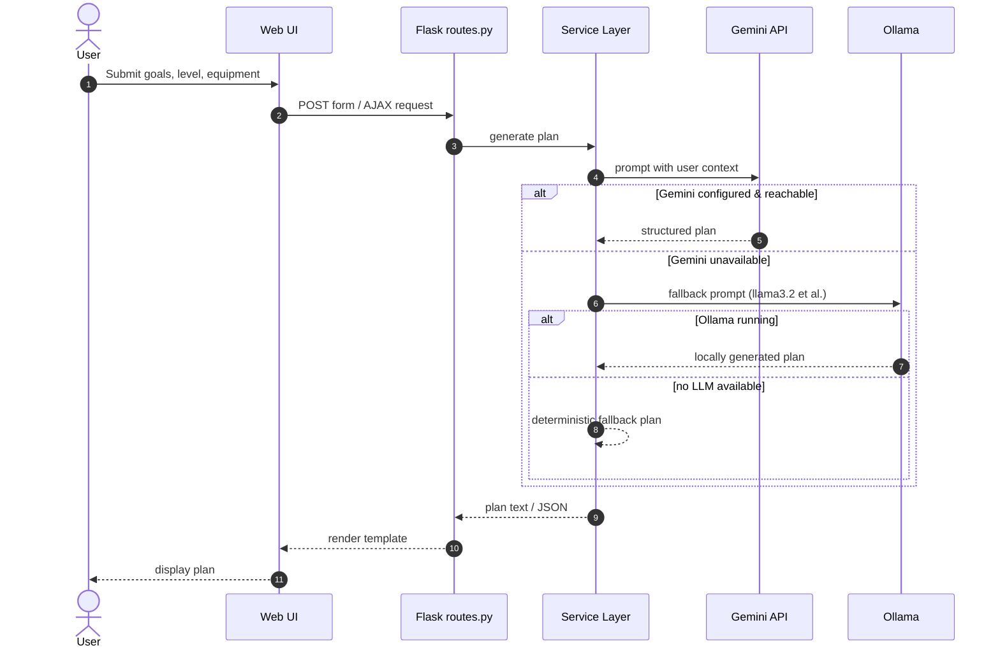
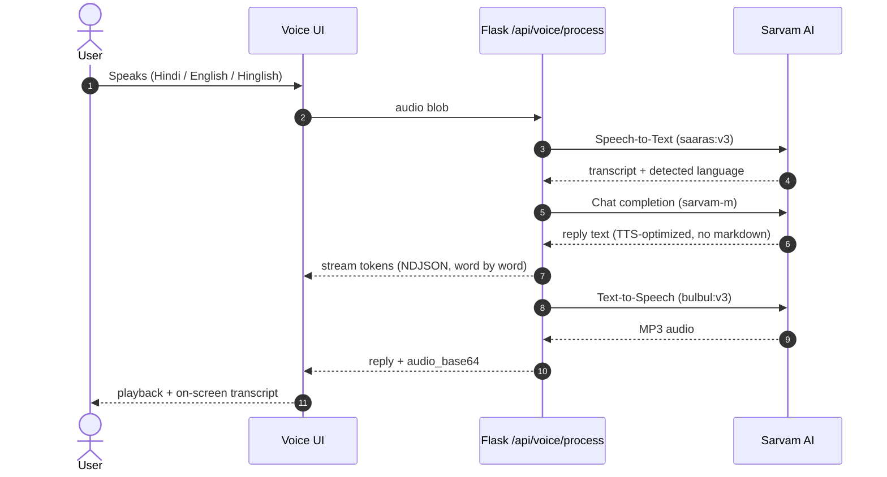
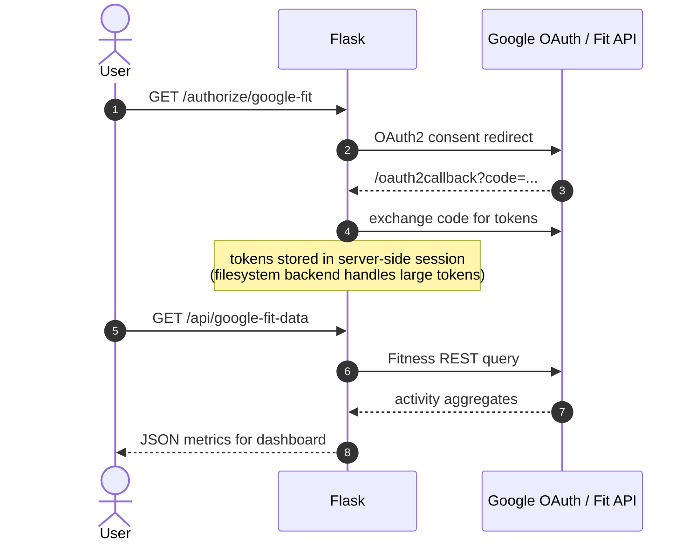
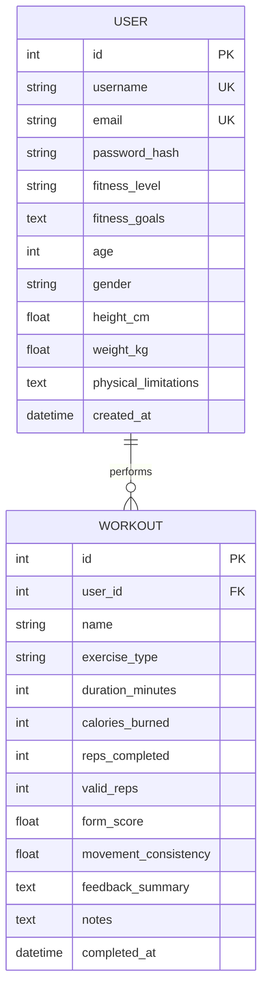
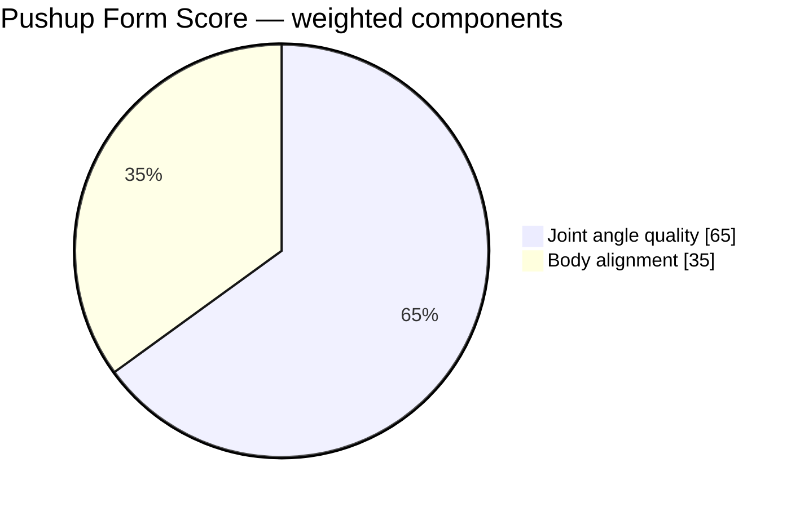
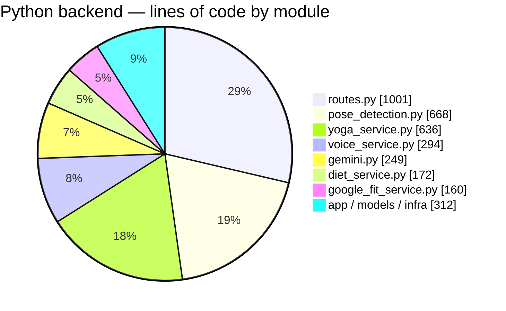

# VisionFit AI 🏋️‍♂️🥗🧘‍♀️


**VisionFit AI** is a comprehensive, AI-powered health and fitness platform that acts as your personal digital coach. It combines **real-time computer vision** for exercise form analysis with **Generative AI** (Google Gemini, local LLMs via Ollama, and Sarvam AI) to deliver personalized workout, diet, and yoga plans — plus a bilingual voice assistant.

> Built as a B.Tech project: MediaPipe 33-point pose tracking, vector-based biomechanics, ML exercise recognition, and multi-provider LLM orchestration.

---

## ✨ Key Features

| Module | Powered By | What It Does |
|---|---|---|
| 🤖 **AI Workout Planner** | Gemini 2.0 Flash → Ollama fallback | Generates 4-week plans from fitness level, goals, equipment & physical limitations |
| 📹 **Real-Time Exercise Analysis** | MediaPipe + OpenCV + scikit-learn | Live webcam form tracking for **Pushups, Squats, Jumping Jacks** with rep counting, form score & voice cues |
| 🍎 **AI Diet Planner** | Ollama (`llama3.2`, auto-detects models) | 1-day meal plans with macros (protein / carbs / fats / calories), respects preferences & allergies |
| 🧘 **AI Yoga Instructor** | Ollama | Custom yoga flows by mood, goal & duration — includes Chair/Bed yoga for limited mobility, with 26 pose illustrations |
| 💬 **AI Fitness Chat** | Gemini 2.0 Flash → Ollama fallback | Context-aware Q&A assistant that knows your profile |
| 🎙️ **Bilingual Voice Assistant** | Sarvam AI (`saaras:v3` STT · `sarvam-m` chat · `bulbul:v3` TTS) | Hands-free Hindi / English / Hinglish conversation, streaming responses |
| 📊 **Dashboard & Google Fit** | Chart.js + Google Fit API | Workout stats, calories, streaks, progress charts, and OAuth2-based Google Fit sync |

---

## 🏗️ System Architecture



---

## 🔬 Real-Time Exercise Analysis Pipeline

The browser extracts 33 body landmarks with MediaPipe, then the server performs biomechanical analysis — no video ever leaves the machine, only landmark coordinates.



### 🔁 Pushup Rep-Counting State Machine



---

## 🧠 AI Plan Generation — Graceful Fallback Chain

Every LLM feature degrades gracefully: cloud model first, local model second, deterministic plan last.



---

## 🎙️ Bilingual Voice Assistant (Sarvam AI)



---

## 🔗 Google Fit Sync (OAuth 2.0)



---

## 🗄️ Data Model



---

## 📊 Project Analytics

**Form score composition** (real scoring weights from `pose_detection.py`):



**Backend composition** (lines of Python per module):



---

## 🛠️ Technology Stack

| Layer | Technologies |
|---|---|
| **Backend** | Python 3.11, Flask 2.3, Flask-Login, Flask-Session (filesystem), SQLAlchemy, Werkzeug |
| **Frontend** | Jinja2, Bootstrap 5, Vanilla JS, Chart.js, dark neon glassmorphic theme |
| **Computer Vision** | MediaPipe Pose (client-side), OpenCV, NumPy, scikit-learn (RandomForest) |
| **Cloud AI** | Google Gemini (`gemini-2.0-flash`) via `google-genai` |
| **Local AI** | Ollama — `llama3.2` default, auto-detects `qwen2.5`, `mistral`, `llama3`, `gemma`, `tinyllama` |
| **Voice AI** | Sarvam AI — `saaras:v3` (STT), `sarvam-m` (chat), `bulbul:v3` (TTS) |
| **Integrations** | Google Fit REST API, OAuth 2.0 (`google-auth-oauthlib`) |
| **Database** | SQLite (dev) · PostgreSQL via `psycopg2-binary` (prod) |
| **Deployment** | Gunicorn, Procfile, Railway / Render / Heroku ready |

---

## 📂 Project Structure

```text
VISION-FIT-AI/
├── app.py                  # Application factory, DB + session config
├── run.py                  # WSGI entrypoint (gunicorn run:app)
├── start_app.py            # Local launcher (auto-starts Ollama + Flask)
├── run_visionfit.bat       # One-click Windows launcher
├── routes.py               # 40+ routes: pages + JSON APIs
├── models.py               # User (biometrics + BMI) & Workout models
├── extensions.py           # SQLAlchemy + LoginManager singletons
├── gemini.py               # Gemini engine with Ollama fallback
├── pose_detection.py       # Landmarks, RF classifier, rep counters, feedback
├── diet_service.py         # Ollama nutrition planner
├── yoga_service.py         # Ollama yoga sequence generator
├── voice_service.py        # Sarvam STT + chat + TTS (Hindi/English/Hinglish)
├── google_fit_service.py   # OAuth2 flow + fitness data fetch
├── requirements.txt        # Pinned dependencies
├── runtime.txt             # python-3.11.9
├── Procfile                # web: gunicorn run:app
├── .env.example            # Environment template (placeholders only)
├── static/
│   ├── css/style.css       # Glassmorphic neon theme
│   ├── js/                 # dashboard.js, exercise_analysis.js, pose-detection.js
│   ├── dist/               # Bundled assets
│   ├── yoga_images/        # 26 pose illustrations
│   └── favicon.ico, h1-h4.jpg
├── templates/              # 11 Jinja2 pages (base, dashboard, exercise_analysis,
│                           #  workout_planner, diet, yoga, fitness_chat, voice_assistant …)
└── frontend/               # Optional JS tooling scaffold (package.json only)
```

---

## 🚀 Getting Started

### Prerequisites
- Python 3.11+
- [Ollama](https://ollama.com/) *(optional — required only for local Diet/Yoga generation)*
- A Google AI Studio key for Gemini *(required for Workout Planner & Chat)*
- A Sarvam AI key *(required for the Voice Assistant)*

### 1. Clone & create a virtual environment
```bash
git clone https://github.com/rishabhverma007/VISION-FIT-AI.git
cd VISION-FIT-AI

python -m venv .venv
# Windows
.venv\Scripts\activate
# macOS / Linux
source .venv/bin/activate
```

### 2. Install dependencies
```bash
pip install -r requirements.txt
```

### 3. Configure environment
```bash
copy .env.example .env    # Windows  (cp on macOS/Linux)
```
Fill in your own keys in `.env` (never commit this file):

```ini
SESSION_SECRET=change-me-to-a-random-string
DATABASE_URL=sqlite:///visionfit.db
GOOGLE_API_KEY=your-gemini-api-key
SARVAM_API_KEY=your-sarvam-api-key
GOOGLE_CLIENT_ID=your_client_id_here          # optional, Google Fit
GOOGLE_CLIENT_SECRET=your_client_secret_here  # optional, Google Fit
GOOGLE_REDIRECT_URI=http://localhost:5000/oauth2callback
PORT=5000
```

### 4. Set up local AI (optional)
```bash
ollama pull llama3.2        # or qwen2.5 / mistral / llama3
```
The services auto-detect whichever preferred model is installed.

### 5. Run

```bash
# Windows one-click (starts Ollama if installed, then Flask):
run_visionfit.bat

# Or directly:
python start_app.py
```

Open **http://localhost:5000** 🎉

---

## 🧭 Usage Guide

1. **Register / Login** — create an account; biometrics (age, height, weight) power BMI and calorie math.
2. **Dashboard** — view streaks, calories, form-score trends; connect Google Fit for extra telemetry.
3. **Workout Planner** — enter goals, equipment, limitations → get a 4-week plan.
4. **Exercise Analysis** — pick Pushup / Squat / Jumping Jack (or *auto* for ML detection), grant camera access, stand back so your full body is visible, and train with live rep counting, form score and voice cues.
5. **Diet / Yoga** — generate instant plans locally via Ollama (yoga ships with 26 pose illustrations).
6. **Fitness Chat** — ask anything; the assistant has your profile context.
7. **Voice Assistant** — talk in Hindi, English or Hinglish and get spoken replies.

---

## 🌐 API Reference

| Group | Endpoint | Method | Purpose |
|---|---|---|---|
| Auth | `/register`, `/login`, `/logout` | GET/POST | Account management |
| Pages | `/dashboard`, `/exercise-analysis`, `/workout_planner`, `/diet`, `/yoga`, `/fitness_chat`, `/voice-assistant` | GET | Rendered pages (login required) |
| Pose | `/api/analyze-pose` | POST | Landmarks → reps, form score, feedback |
| Pose | `/api/pose-detection` · `/api/reset-pose-session` | POST | Alternate detector / reset counters |
| Workouts | `/api/save-workout` · `/api/workout-history` · `/api/dashboard-stats` | GET/POST | Persist & aggregate sessions |
| AI | `/api/fitness-chat` · `/api/generate-diet-plan` · `/api/generate-yoga-plan` | POST | LLM-generated content |
| Voice | `/api/voice/process` (streaming) · `/api/voice/process_legacy` · `/api/voice/process_text` · `/api/voice/clear` | POST | STT → chat → TTS pipeline |
| Google Fit | `/authorize/google-fit` · `/oauth2callback` · `/api/google-fit-data` | GET | OAuth2 + telemetry |
| Data | `/api/export-data` · `/api/import-data` · `/api/backup-data` · `/api/restore-data` · `/api/clear-data` | GET/POST | Backup & portability |
| Meta | `/api/health-check` · `/api/version` · `/api/docs` | GET | Ops endpoints |

---

## ☁️ Deployment

Production-ready for **Railway**, **Render**, or **Heroku**:

- **Entrypoint:** `Procfile` → `web: gunicorn run:app`
- **Runtime:** `runtime.txt` → `python-3.11.9`
- **Port:** binds to `0.0.0.0:$PORT` automatically
- **Proxy:** `ProxyFix` enabled for correct scheme/host behind load balancers

**Steps (Railway/Render):**
1. Connect this GitHub repository.
2. Build command: `pip install -r requirements.txt`
3. Start command: `gunicorn run:app`
4. Set environment variables: `SESSION_SECRET`, `GOOGLE_API_KEY`, `SARVAM_API_KEY`, and optionally `DATABASE_URL` (PostgreSQL URI — the app auto-normalizes Railway's `postgres://` scheme).

---

## 🔐 Security Notes

- **Never commit `.env`** — it is git-ignored; `.env.example` contains placeholders only.
- If API keys were ever shared or committed accidentally, **rotate them** in Google AI Studio / Sarvam dashboard immediately.
- Sessions are server-side (filesystem) with signed cookies — OAuth tokens never live in the browser.
- Passwords are hashed with Werkzeug PBKDF2.

---

## 🤝 Contributing

Contributions are welcome! Fork the repository, create a feature branch, and open a pull request.

## 📄 License

[MIT License](LICENSE)
